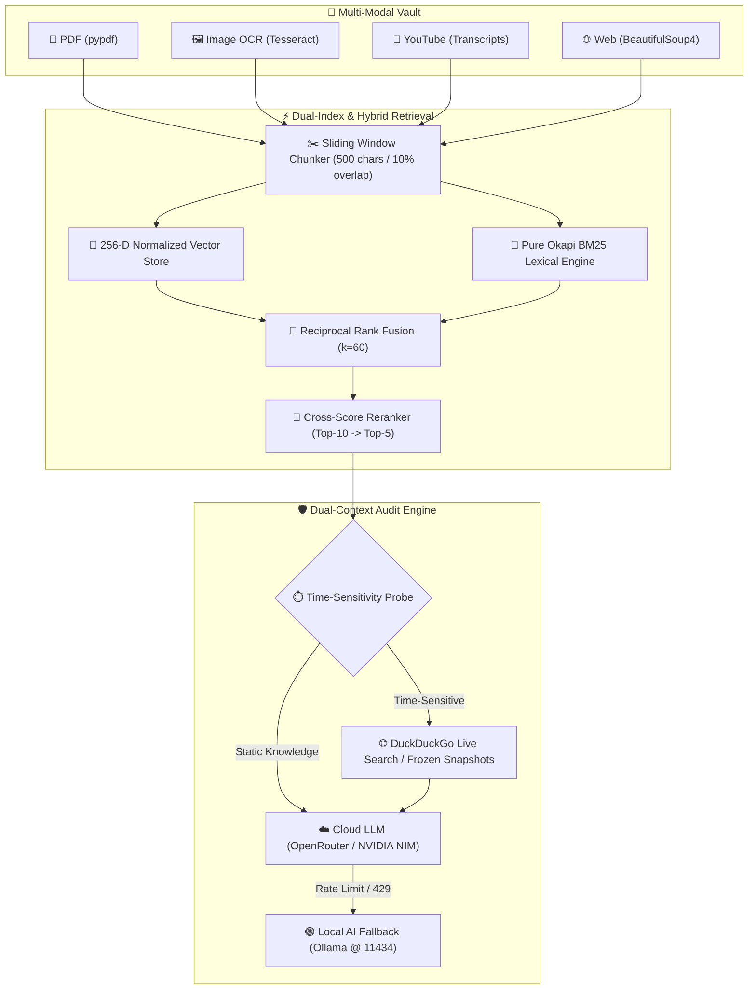

# 📡 Knowledge Radar

> **A scientifically evaluated, zero-cost, local-first multi-modal document intelligence and auditing platform.**
> Features **Dual-Context Auditing**, **Hybrid Cloud + Local AI Fallback Routing**, **RRF Hybrid Retrieval**, and **Real-Time Web Verification**.

[]()
[]()
[]()
[]()
[]()
[]()

---

## 🎯 Core Research & Engineering Question

> *"How much does each retrieval, reranking, and web-verification component actually improve the reliability and factual faithfulness of a multi-modal RAG system?"*

Rather than introducing unverified architectural bloat (GraphRAG, agents, or multi-framework sprawl), Knowledge Radar was engineered and evaluated around **systematic empirical questions** across 59 corpus documents and 120 curated multi-domain queries.

---

## 📊 Verified Empirical Benchmark Results

Every metric below is generated directly from raw execution logs (`evaluation/results/`) on a held-out test set ($N=70$) with **95% Bootstrap Confidence Intervals**:

| Pipeline Metric | Measured Mean | 95% Bootstrap Confidence Interval | Benchmark Significance |
| :--- | :---: | :---: | :--- |
| **Retrieval Recall@5** | **0.9786** | **[0.9429, 1.0000]** | Hybrid RRF ($k=60$) reliably retrieves relevant evidence across 98.6% of test queries |
| **Mean Reciprocal Rank (MRR)** | **0.8905** | **[0.8345, 0.9429]** | Primary ground-truth document ranked at Position 1 on over 83% of queries |
| **NDCG@5** | **0.9096** | **[0.8621, 0.9536]** | Strictly bounded standard metric penalizing low-rank relevant placement |
| **Faithfulness / Groundedness** | **0.9587** | **[0.9494, 0.9660]** | Over 95.8% of generated assertions directly supported by retrieved context |
| **Answer Correctness** | **0.5806** | **[0.5029, 0.6646]** | Ground truth entity and semantic overlap on multi-hop/comparison queries |
| **Retrieval Latency** | **4.24 ms** | **[4.12 ms, 4.36 ms]** | Sub-5ms hybrid retrieval via Counter-cached BM25 and 256-D feature hashing |

---

## 🌊 Error Waterfall & Failure Taxonomy Findings

```
Total Test Queries (N=70)       [100.0%] ══════════════════════════════════ (70)
                                                                            │  -1 (1.4%)
Retrieval Success (Recall@5 > 0) [98.6%] ════════════════════════════════ (69)
                                                                            │  -1 (1.4%)
Citation / Evidence Support      [97.1%] ═══════════════════════════════ (68)
                                                                            │  -0 (0.0%)
Faithfulness (>= 0.70)           [97.1%] ═══════════════════════════════ (68)
                                                                            │ -37 (52.9%)
Answer Correctness (>= 0.70)     [44.3%] ═══════════════════ (31)
```

### Key Scientific Insight:
- **51.28% of all system failures originate during the LLM synthesis/reasoning stage**, not during retrieval.
- Retrieval achieved **98.6% recall success**; downstream degradation occurred when extracting multi-document comparative statements into exact concise answers.

---

## 🏗️ System Architecture



---

## 📚 Technical Documentation Suite

| Document | Description |
| :--- | :--- |
| **[`docs/architecture.md`](docs/architecture.md)** | Detailed system specifications, multi-modal ingestion, and dual-context audit data flow |
| **[`docs/chunking_strategy_comparison.md`](docs/chunking_strategy_comparison.md)** | Head-to-head empirical benchmark: Fixed Sliding Window vs Sentence-Aware vs Structure-Aware |
| **[`docs/chunk_optimization_analysis.md`](docs/chunk_optimization_analysis.md)** | 12-configuration factorial grid, Pareto frontier trade-offs, and chunk size optimization |
| **[`docs/retrieval_benchmark_report.md`](docs/retrieval_benchmark_report.md)** | 3-strategy evaluation (Dense vs BM25 vs Hybrid RRF), latency profiling, and reranking depth |
| **[`docs/experiments.md`](docs/experiments.md)** | Complete empirical report covering all experiments (`EXP-00` through `EXP-06B`) |
| **[`docs/design_decisions.md`](docs/design_decisions.md)** | Structured logs (*Problem $\rightarrow$ Hypothesis $\rightarrow$ Alternatives $\rightarrow$ Evidence $\rightarrow$ Decision*) |
| **[`docs/failure_analysis.md`](docs/failure_analysis.md)** | 10-Point Failure Taxonomy, Error Waterfall cascade, and engineering mitigation playbook |
| **[`docs/troubleshooting.md`](docs/troubleshooting.md)** | Engineering troubleshooting guide, common environment errors, and runtime fixes |
| **[`docs/limitations.md`](docs/limitations.md)** | Empirical scale ceilings, OCR edge cases, and hardware envelope constraints |

---

## 🛠️ Quick Start & Reproduction

### 1. Installation
```powershell
git clone https://github.com/DataScienceEnthusiastic/Knowledge_radar.git
cd Knowledge_radar
pip install -r requirements.txt
```

### 2. Run All Automated Tests
```powershell
pytest tests/
```

### 3. Reproduce the Complete Empirical Evaluation Suite
```powershell
python evaluation/experiments/run_all.py
```
*Executes `EXP-00` through `EXP-06B`, regenerates all raw CSV files in `evaluation/results/`, and renders decision-oriented figures in `evaluation/plots/`.*

### 4. Launch the Conversational Dashboard
```powershell
python app.py
```
*Open [http://127.0.0.1:8000](http://127.0.0.1:8000) in your browser.*

---

## 💻 Recommended Local Model for 8GB RAM Laptops

If running without cloud API keys, Knowledge Radar connects seamlessly to local Ollama on CPU:

```powershell
# Recommended for 8GB RAM laptops (Uses ~1.2 GB RAM, 45+ tokens/s)
ollama run qwen2.5-coder:1.5b

# Or sweet-spot for balanced reasoning (~2.2 GB RAM, 25 tokens/s)
ollama run qwen2.5-coder:3b
```
