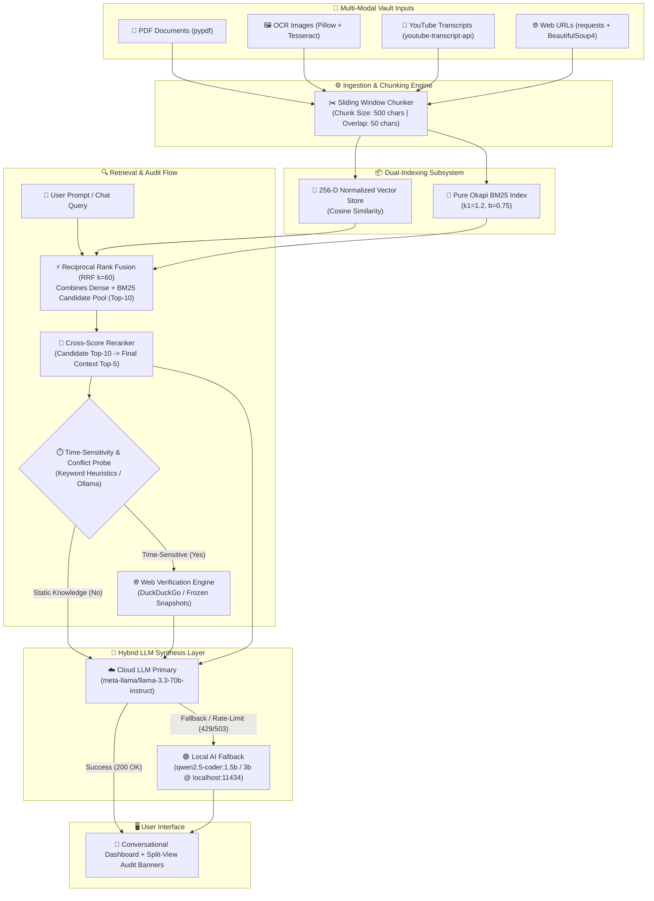

# 📡 Knowledge Radar — System Architecture & Technical Specifications

> **Knowledge Radar** is a zero-latency, local-first multi-modal document intelligence and auditing platform. It implements **Dual-Context Auditing**, **Hybrid LLM Routing** (Cloud Primary + Local AI Fallback), and **Real-Time Web Verification**.

---

## 1. High-Level System Architecture

---

## 2. Core Subsystems

### 2.1 Multi-Modal Ingestion & Extractor Subsystem (`modules/extractors/` & `modules/parser.py`)
Each modal extractor is isolated in its own dedicated module, allowing individual components to be modified, extended, or replaced without side effects:
- **`modules/extractors/pdf_extractor.py`**: Ingests multi-page PDFs using `PyMuPDF`, `pdfplumber`, or `pypdf`, extracting reading order, heading paths (`1. Intro > 1.1 Setup`), table structures, and scanned-page OCR fallback.
- **`modules/extractors/image_extractor.py`**: Standalone image extraction (PNG, JPEG, WebP) with auto-detected Tesseract OCR, line-level bounding boxes, and optional vision model adapters.
- **`modules/extractors/web_extractor.py`**: Fetches article HTML via streaming requests with SSRF security gating (blocking localhost, LAN, and cloud metadata IPs), parsing semantic DOM hierarchies and tables.
- **`modules/extractors/youtube_extractor.py`**: Fetches official and auto-generated transcripts with timestamp annotations (`[MM:SS]`) via `youtube-transcript-api` and public oEmbed metadata.
- **`modules/extractors/storage.py`**: Persists structured entities into normalized SQLite tables and indexed ChromaDB vector collections.
- **`modules/parser.py`**: Lightweight wrappers and sentence-aware / sliding-window chunking engines.

### 2.2 Dual Indexing & Hybrid Retrieval Engine (`evaluation/adapters/retriever_adapter.py`)
- **Dense Vector Engine**: Lightweight 256-dimensional feature projection vectorizer with L2-normalized cosine distance calculation.
- **Pure Python BM25**: Full Okapi BM25 ($k_1=1.2, b=0.75$) with term saturation and smoothed inverse document frequency (IDF).
- **Reciprocal Rank Fusion (RRF)**: Combines dense and lexical candidate ranks without requiring score normalization:
  $$RRF\_Score(d) = \sum_{m \in \{Dense, BM25\}} \frac{1}{k + Rank_m(d)} \quad (k=60)$$

### 2.3 Cross-Score Candidate Reranker (`evaluation/adapters/reranker_adapter.py`)
- Pulls an initial candidate pool of $K=10$ chunks from the hybrid retriever.
- Applies cross-token density, n-gram phrase matching, and positional proximity weighting to select the final Top-5 context chunks.
- Incurs a minimal computational latency overhead of only **0.33 ms** per query.

### 2.4 Real-Time Web Verification & Conflict Detection (`modules/web_search.py`)
- **Adaptive Time-Sensitivity Probe**: Analyzes queries for temporal markers (e.g., *latest*, *current*, *2025*, *price*, *status*).
- **Dual-Context Auditing**: If time-sensitivity is detected, searches external sources via DuckDuckGo (or frozen verified snapshots) and cross-checks external assertions against local document context.
- **Contradiction Resolution**: When document facts conflict with live reality, flags discrepancies and surfaces the latest verified data.

### 2.5 Hybrid LLM Router (`modules/llm_router.py`)
- **Cloud Primary**: Connects via OpenAI SDK to OpenRouter / NVIDIA NIM (`meta-llama/llama-3.3-70b-instruct`).
- **Local Fallback**: Automatically routes to local Ollama (`qwen2.5-coder:1.5b` or `qwen2.5-coder:3b`) on HTTP status 429 (rate limit), 401 (invalid key), or offline network state.
