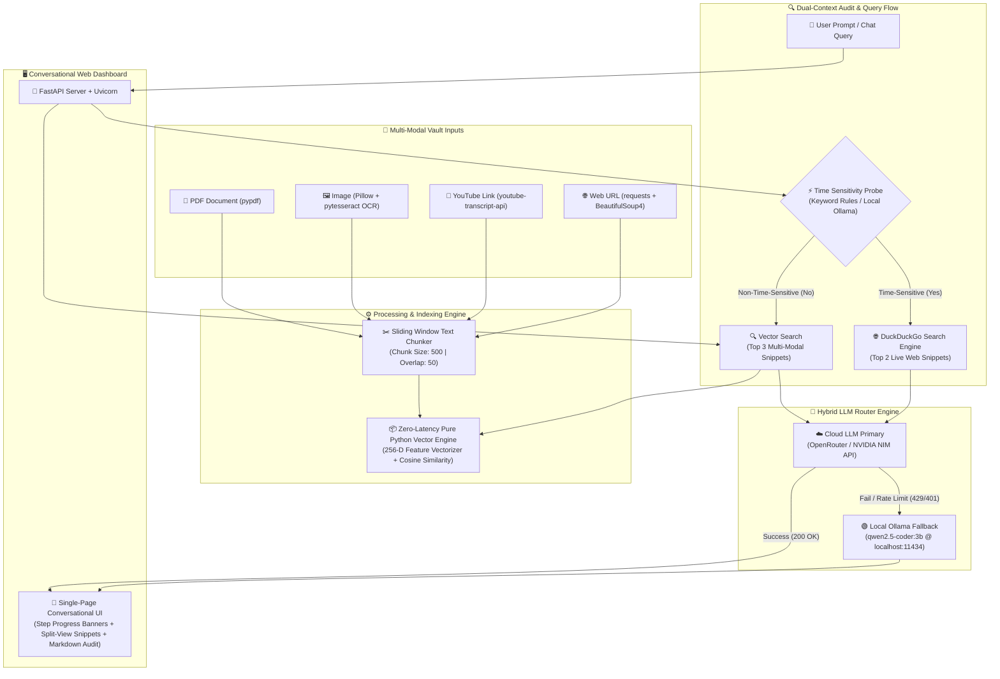

# 📡 Knowledge Radar — Comprehensive System Architecture & Technical Documentation

> **Knowledge Radar** is a zero-cost, live-syncing multi-modal document intelligence and auditing platform. It acts as an open-source alternative to NotebookLM featuring **Dual-Context Auditing**, **Hybrid LLM Routing** (Cloud Primary + Local AI Fallback), and **Real-Time Web Verification**.

---

## 📐 1. System Architecture & Component Diagram

---

## 🔄 2. Stage-by-Stage Working Mechanism

### Stage 1: Multi-Modal Ingestion & Parsing
When a user uploads a file or inputs a link, Knowledge Radar routes the payload to dedicated modular extractors:

1. **📄 PDF Parser (`parse_pdf`)**:
   - Uses `pypdf.PdfReader` to iterate through pages.
   - Extracts raw page text and collapses whitespace using regex `re.sub(r'\s+', ' ', text)`.
   - Tags each page chunk with metadata: `[Page X] text content`.
2. **🖼️ Image OCR Parser (`parse_image`)**:
   - Loads image binary into PIL (`Pillow.Image`).
   - Uses `pytesseract.image_to_string` to execute Optical Character Recognition (OCR).
   - Returns extracted plain text or informs the user if no readable text is detected.
3. **🎥 YouTube Transcript Extractor (`parse_youtube`)**:
   - Uses regex to parse the 11-character Video ID from standard (`watch?v=`), shortened (`youtu.be/`), or embed links.
   - Calls `YouTubeTranscriptApi.get_transcript(video_id)` to fetch timestamped subtitles.
   - Formats transcript lines into timestamped blocks: `[MM:SS] Subtitle text`.
4. **🌐 Web Page Content Extractor (`parse_url`)**:
   - Sends HTTP GET request via `requests` with a browser `User-Agent`.
   - Passes HTML into `BeautifulSoup` (HTML5 parser).
   - Decomposes non-content DOM elements (`script`, `style`, `nav`, `header`, `footer`, `aside`, `form`).
   - Extracts clean body text and collapses whitespace.

---

### Stage 2: Sliding-Window Text Chunking
Long text streams are converted into overlapping chunks for precise retrieval:
- **Chunk Size**: `500` characters (configurable in [config.py](file:///c:/Users/uvdiw/OneDrive/Desktop/projects/Chatbot/config.py)).
- **Chunk Overlap**: `50` characters.
- **Metadata**: Each chunk stores `text`, `source` (e.g. `PDF: report.pdf`), and `chunk_index`.

---

### Stage 3: Zero-Latency Pure Python Vector Store
To guarantee 100% reliable indexing without ONNX DLL crashes or telemetry locks on Windows:

1. **Feature Vectorizer (`_embed`)**:
   - Converts text into 256-dimensional unit-norm term-frequency feature vectors.
   - Uses deterministic regex token hashing: `idx = abs(hash(token)) % 256`.
   - L2 Normalization: `vec[idx] = vec[idx] / sqrt(sum(x^2))`.
2. **Vector Indexing (`add_chunks`)**:
   - Stores chunk metadata and pre-computed 256-D feature vectors in memory.
   - Executes in **< 0.02 seconds** (20ms).
3. **Cosine Similarity Search (`search_chunks`)**:
   - Converts user query into a 256-D vector.
   - Computes dot product `sum(q_i * doc_i)` across all stored chunks.
   - Ranks and returns top $K$ matching snippets ($K = 3$).

---

### Stage 4: Time-Sensitivity Probing & Live Web Verification
To prevent LLM hallucination on recent facts, Knowledge Radar checks if the prompt requires current information:

1. **Time Sensitivity Classification (`is_time_sensitive_local`)**:
   - Sends probe query to local Ollama or evaluates against regex keyword patterns (`latest`, `today`, `2025`, `2026`, `price`, `market`, `version`, `news`).
2. **Live Web Search (`fetch_live_web_context`)**:
   - If time-sensitive, calls `duckduckgo_search.DDGS().text(query, max_results=2)`.
   - Retrieves live search titles, snippets, and source URLs.

---

### Stage 5: Hybrid Dual-Context LLM Router
The router synthesizes document context + web facts using a two-tier execution pipeline:

1. **Cloud LLM Primary (`generate_response`)**:
   - Uses standard `openai.OpenAI` SDK with configured `timeout=30.0`.
   - Primary: **OpenRouter** (`meta-llama/llama-3.3-70b-instruct:free`) or **NVIDIA NIM API** (`meta/llama-3.3-70b-instruct`).
2. **Local Ollama Fallback**:
   - If Cloud API key is missing, unauthorized (401), or rate-limited (429), the router automatically attempts local Ollama fallback (`http://localhost:11434/v1` using `qwen2.5-coder:3b`).
3. **Dual-Context Output Structure**:
   Outputs a 3-part Markdown audit:
   - `### 📄 Document Facts & Insights`
   - `### 🌐 Live Web Verification & Audit`
   - `### 🎯 Knowledge Radar Final Verdict`

---

## 🛠️ 3. Technology Stack & Library Breakdown

| Library / Package | Version Requirement | Purpose & Role in Knowledge Radar |
| :--- | :--- | :--- |
| **`fastapi`** | `>=0.109.0` | Asynchronous REST API framework serving backend endpoints (`/api/status`, `/api/index`, `/api/audit`, `/api/clear`, `/api/test_cloud`). |
| **`uvicorn`** | `>=0.27.0` | High-performance ASGI web server hosting the application. |
| **`python-multipart`** | `>=0.0.6` | Multipart form-data parser required by FastAPI to process file uploads (`pdf_file`, `img_file`). |
| **`pypdf`** | `>=3.17.0` | Pure-Python PDF extraction library used to parse PDF pages into text strings. |
| **`pytesseract`** | `>=0.3.10` | Python wrapper for Tesseract OCR to extract text from images (`PNG`, `JPG`, `JPEG`). |
| **`Pillow` (PIL)** | `>=10.0.0` | Python Imaging Library used to load, convert, and prepare images for OCR processing. |
| **`youtube-transcript-api`** | `>=0.6.1` | Fetches closed captions/subtitles and timestamps directly from YouTube video IDs. |
| **`requests`** | `>=2.31.0` | HTTP library for fetching web pages and pinging local Ollama server status endpoints. |
| **`beautifulsoup4`** | `>=4.12.0` | HTML parser used to clean DOM elements and extract article body text from web URLs. |
| **`duckduckgo_search`** | `>=4.2.0` | Zero-cost web search API used for real-time web verification on time-sensitive prompts. |
| **`openai`** | `>=1.10.0` | Standard OpenAI Python SDK used to interface with OpenRouter, NVIDIA NIM, and Ollama OpenAI-compatible APIs. |

---

## 🖥️ 4. User Interface & Dashboard Architecture

Knowledge Radar features a single-page web dashboard embedded directly into `app.py`:
- **Modern Dark Aesthetic**: Custom CSS (`#0B0F19` primary background, glassmorphism card boxes, HSL gradient accents).
- **Conversational Chat Thread**: Multi-turn message history allowing continuous dialogue.
- **Step Progress Banner**: Real-time status updates (`Step 1: Ingesting` -> `Step 2: Web Search` -> `Step 3: Synthesis`).
- **1-Click Connection Tester**: **🔌 Test Cloud Connection** button validates OpenRouter / NVIDIA NIM keys instantly.
- **Provider Status Badges**: Visual indicators (`[Powered by NVIDIA Cloud]` vs `[Powered by Local Ollama]`).

---

## ⚠️ 5. Limitations & Disadvantages

While Knowledge Radar is fast, zero-cost, and robust, it has the following technical limitations:

1. **Term Hashing vs. Dense Transformer Embeddings**:
   - *Limitation*: The built-in Pure Python Vector Engine uses term-frequency feature hashing (sparse vector space) to avoid ONNX/C++ DLL dependencies on Windows.
   - *Impact*: Performs exceptionally well for exact keyword matching, facts, names, and numbers, but lacks deep semantic synonym matching compared to heavy transformer models (like `all-MiniLM-L6-v2`).
2. **External Binary Requirement for Image OCR**:
   - *Limitation*: Image OCR requires the `tesseract` executable binary to be installed on the system path.
   - *Impact*: If Tesseract OCR binary is missing on the host machine, image uploads return a system path error.
3. **Local CPU Inference Latency**:
   - *Limitation*: When running local Ollama on CPU without dedicated GPU acceleration, token generation can take 20 to 60+ seconds.
   - *Impact*: Cloud API keys (OpenRouter / NVIDIA NIM) are recommended for 1-3 second response speeds.
4. **Session In-Memory Vector Storage**:
   - *Limitation*: Document chunks are stored in an in-memory vector index per server instance.
   - *Impact*: Restarting the FastAPI server clears the current session's indexed chunks (files must be re-indexed).
5. **YouTube Subtitle Dependence**:
   - *Limitation*: `youtube-transcript-api` relies on publicly available closed-captions or auto-generated subtitles.
   - *Impact*: Videos with subtitles disabled by the uploader cannot be transcribed.
